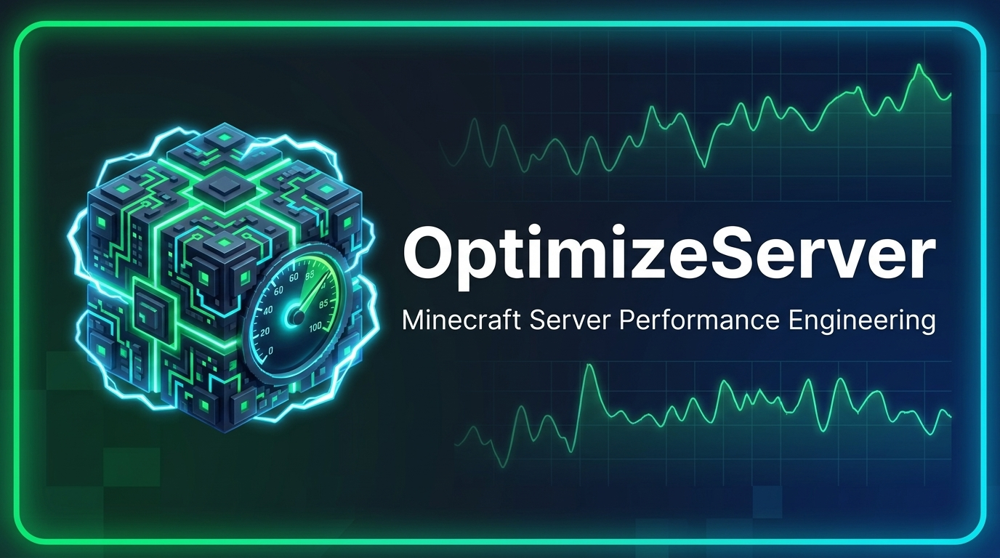

# OptimizeServer

<p align="center">
  
</p>

[](https://modrinth.com/plugin/optimizeserver-notgamerpratham)
[](https://www.spigotmc.org/resources/optimizeserver.140480/)
[](https://github.com/NotGamerPratham/OptimzeServer/releases/latest)
[](https://github.com/NotGamerPratham/OptimzeServer/actions/workflows/maven.yml)
[](LICENSE)

**Author:** NotGamerPratham  
**Main Package:** `com.pratham.optimizeserver`  
**Main Class:** `com.pratham.optimizeserver.OptimizeServer`  
**Artifact:** `OptimizeServer.jar`  
**Primary Command:** `/optimizeserver` (Alias: `/os`)

**OptimizeServer** is a production-grade Minecraft Java Edition server performance engineering, bottleneck diagnostics, and non-invasive execution optimization plugin. It is engineered to maximize server execution efficiency, minimize monitoring overhead, and provide evidence-backed diagnostics while preserving 100% of vanilla Minecraft gameplay semantics.

---

## 1. Core Philosophy & Gameplay Preservation Guarantee

OptimizeServer strictly preserves all 16 vanilla gameplay invariants:

- Vanilla gameplay mechanics & game rules
- Entity behaviour, mob AI, and entity spawning
- Player movement, combat calculations, inventory mechanics, and player interactions
- Block interactions, redstone behaviour, game physics, and random tick behaviour
- World generation, chunk loading semantics, and gameplay-related packet semantics

OptimizeServer **never** skips server ticks, falsifies TPS readings, removes entities, disables mob AI, reduces simulation/view distance, forces `System.gc()`, or mutates world configuration.

---

## 2. Compatibility Matrix

| Server Platform | Supported | Execution Model | Notes |
| --- | --- | --- | --- |
| **Paper** | Yes | Main Thread + Async Workers | Uses native TPS/MSPT APIs + monotonic rolling windows |
| **Purpur** | Yes | Main Thread + Async Workers | Full Paper API + Purpur detection |
| **Pufferfish / Airplane** | Yes | Main Thread + Async Workers | Full Paper-derivative capability support |
| **Gale / Leaves** | Yes | Main Thread + Async Workers | Full Paper-derivative capability support |
| **Folia** | Yes | Regionalized Multithreading | Uses `GlobalRegionScheduler`, `RegionScheduler`, `EntityScheduler` & event-driven chunk/entity counters |
| **Spigot / CraftBukkit** | Yes | Main Thread + Async Workers | Uses monotonic `System.nanoTime()` MSPT/TPS fallback and reflective ping fallback |
| **Unknown Bukkit Forks** | Safe Mode | Conservative Safe Mode | Automatically activates `SafeModeController` |

### Minecraft & Java Runtime Compatibility

- **Universal JAR (`universal-java8` default build profile):** Compiled targeting Java 8 bytecode (`class version 52.0`) with `api-version: '1.13'` and `folia-supported: true`. Runs on **Java 8, 11, 16, 17, 21, and 25+** across Minecraft **1.8.8 through 1.21.x+**.
- **Optional Modern Profiles:** `modern-java17` (MC 1.18–1.20.4) and `modern-java21` (MC 1.20.5–1.21.x+) are included in `pom.xml`.

---

## 3. Download

| Platform | Link | Notes |
| --- | --- | --- |
| **Modrinth** | [modrinth.com/plugin/optimizeserver](https://modrinth.com/plugin/optimizeserver-notgamerpratham-notgamerpratham) | Recommended. Versions are published automatically on every release. |
| **SpigotMC** | [spigotmc.org — OptimizeServer](https://www.spigotmc.org/resources/optimizeserver.140480/) | Same JAR, posted to the SpigotMC resource page. |
| **GitHub Releases** | [Latest release](https://github.com/NotGamerPratham/OptimzeServer/releases/latest) | Includes `OptimizeServer.jar` plus `.sha256` / `.sha512` checksums. |

All three platforms ship the identical universal `OptimizeServer.jar` (Java 8+ bytecode, Minecraft 1.8.8 – 1.21.x+, Spigot / Paper / Purpur / Folia and forks).

---

## 4. Installation Instructions

1. Download `OptimizeServer.jar` from one of the platforms above (or build it yourself) and copy it into your server's `plugins/` directory.
2. **Automatic Spark & Chunky Installation:** On server startup, [`DependencyAutoInstaller`](src/main/java/com/pratham/optimizeserver/integrations/DependencyAutoInstaller.java) automatically checks whether **Spark** and **Chunky** are already installed or bundled (e.g., Paper 1.21+ bundled Spark). If either is missing, OptimizeServer asynchronously downloads the official plugin JAR from Modrinth/Spiget, verifies its cryptographic SHA-512 and JAR archive integrity, installs it into `plugins/`, and loads it on the main server thread.
3. Configuration is generated at `plugins/OptimizeServer/config.yml` and local diagnostic reports are saved under `plugins/OptimizeServer/reports/`.

---

## 5. Command Reference & Permissions

| Command | Permission | Description |
| --- | --- | --- |
| `/os help [page]` | `optimizeserver.status` | Paginated command reference |
| `/os version` | `optimizeserver.status` | Platform, Minecraft version, JVM, and integration details |
| `/os status` | `optimizeserver.status` | Unified server performance summary |
| `/os tps` | `optimizeserver.status` | 5s, 30s, 1m, 5m, and 15m rolling TPS |
| `/os mspt` | `optimizeserver.status` | Average, P50, P95, P99, and StdDev MSPT |
| `/os cpu` | `optimizeserver.status` | Process and host system CPU utilization |
| `/os memory` | `optimizeserver.status` | Heap, non-heap, GC pause rate, and allocation telemetry |
| `/os network` | `optimizeserver.status` | Player RTT ping vs server tick/packet processing overhead |
| `/os entities` | `optimizeserver.status` | Read-only entity and tile-entity counts by type and world |
| `/os chunks [status\|recommend\|start\|pause\|cancel]` | `optimizeserver.chunks` | Chunk telemetry and manual Chunky pre-generation controls |
| `/os diagnose [full\|cpu\|memory\|chunks\|entities\|plugins]` | `optimizeserver.diagnose` | Evidence-backed bottleneck classification & recommendations |
| `/os profile <start\|stop\|status\|memory>` | `optimizeserver.profile` | Spark profiler session control and memory diagnostics |
| `/os health` | `optimizeserver.profile` | Combined server and Spark health report |
| `/os optimize [status\|list\|enable\|disable\|rollback]` | `optimizeserver.optimize` | Manage and rollback internal optimization modules |
| `/os report <generate\|history>` | `optimizeserver.report` | Generate and view saved local diagnostic reports |
| `/os reload` | `optimizeserver.reload` | Reload and re-validate `config.yml` |

All permissions are granted under `optimizeserver.admin` and default to `op`.

---

## 6. Build & Test Instructions

### Prerequisites

- JDK 17 or JDK 21+ (supports `--release 8` cross-compilation)
- Apache Maven 3.8+

### Build Commands

```bash
# Default universal build (Java 8+ bytecode, MC 1.8.8 - 1.21.x+)
mvn clean test package

# Modern Java 17 build profile
mvn clean test package -Pmodern-java17

# Modern Java 21 build profile
mvn clean test package -Pmodern-java21
```

# OptimizeServer.jar is produced at target/OptimizeServer.jar

### Publishing & Consuming via GitHub Packages (Apache Maven Registry)

`pom.xml` is pre-configured with `<artifactId>optimizeserver</artifactId>` (lowercase as required by GitHub Packages) and `<distributionManagement>` pointing to `https://maven.pkg.github.com/notgamerpratham/optimzeserver`.

- **Automated Publishing (GitHub Actions):** Pushing to `main` or creating a release runs [`.github/workflows/maven-publish.yml`](.github/workflows/maven-publish.yml), which executes all JUnit tests, uploads `OptimizeServer.jar`, and publishes `com.pratham:optimizeserver:1.0.0` to GitHub Packages using `GITHUB_TOKEN`.
- **Local Publishing (`mvn deploy`):** Configure `~/.m2/settings.xml` with server `<id>github</id>`, your GitHub username, and a classic Personal Access Token (`write:packages`, `read:packages`), then run:

  ```bash
  mvn deploy
  ```

- **Using as a Maven Dependency:**

  ```xml
  <dependency>
      <groupId>com.pratham</groupId>
      <artifactId>optimizeserver</artifactId>
      <version>1.0.0</version>
      <scope>provided</scope>
  </dependency>
  ```

### Releasing (GitHub Releases, Modrinth, SpigotMC)

1. Bump `<version>` in `pom.xml` and add a matching `## [x.y.z]` entry to `CHANGELOG.md`.
2. Tag and push:

   ```bash
   git tag v1.0.1
   git push origin v1.0.1
   ```

3. [`.github/workflows/release.yml`](.github/workflows/release.yml) then builds and tests the JAR and:
   - **GitHub Releases:** creates the release with `OptimizeServer.jar`, checksums, and the CHANGELOG notes.
   - **Modrinth:** uploads a new version (loaders: Bukkit, Spigot, Paper, Purpur, Folia; every Minecraft release from 1.8.8 onward). This step needs the repository secret `MODRINTH_TOKEN` (a Modrinth PAT with the *Create versions* scope) and the repository variable `MODRINTH_PROJECT_ID`. If either one is missing, the step is skipped.
   - **SpigotMC:** SpigotMC has no upload API, so use *Post Update* on the resource page and upload the JAR from the GitHub Release. You can paste the page description from [`docs/publishing/spigot-description.bbcode`](docs/publishing/spigot-description.bbcode).

---

## 7. Dependencies

- `org.spigotmc:spigot-api` (`provided` — never shaded into the plugin JAR)
- `me.lucko:spark-api:0.1-SNAPSHOT` (`provided`, `optional` — never bundled)
- `org.popcraft:chunky-common` (`provided`, `optional` — never bundled)
- `org.junit.jupiter:junit-jupiter:5.10.2` (`test`)

---

## 8. Known Limitations

1. **Physical Network Latency (RTT):** A server plugin cannot reduce physical internet round-trip time between a player and the host. `NetworkMonitor` separates physical player RTT from server-side tick-overrun and packet processing overhead.
2. **Per-Plugin CPU Attribution:** Exact per-plugin CPU time requires stack sampling via Spark (`/os profile start`). Without an active profiler, `TaskMonitor` reports scheduled task and worker volumes per plugin without falsely claiming exact CPU share.
3. **Folia World Enumeration:** Because Folia enforces strict regionalized thread ownership, `ChunkMonitor` and `EntityMonitor` automatically switch to event-driven counters on Folia rather than iterating `World#getLoadedChunks()` or `World#getEntities()` from the global thread.
4. **Extended 24–72 Hour Soak Testing:** Automated unit, lifecycle, memory-bounds, and micro-benchmark tests execute during the build; full 24–72 hour live production soak testing must be performed on the target host environment prior to large-scale deployment.
